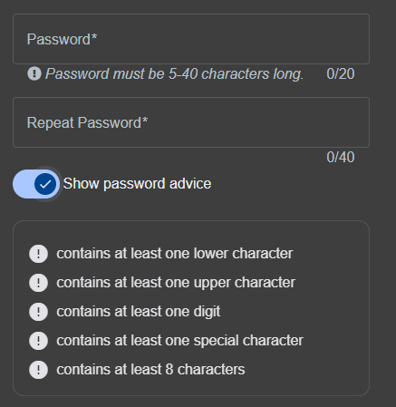
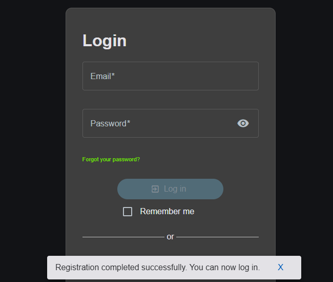

BUG-01: \[Registration] Password advice is not enforced

Environment: OWASP Juice Shop v20.3.0 (local), Chrome, Windows 11

Requirement: REQ-REG-12

Severity: Medium

Status: Draft

Steps:

1. Open the Account menu > Login > "Not yet a customer?"
2. Toggle "Show password advice" on and note the five rules listed
3. Enter a new, unregistered email
4. Enter "12345" in Password and Repeat password
5. Choose a security question and enter an answer
6. Click Register

Expected: Registration is rejected, because "12345" does not meet the advice (no lowercase letter, no uppercase letter or special character, fewer than 8 characters).

Actual: Registration succeeds with "12345"

Additional result: "abcdefgh" (8 lowercase letters, no digit) was also accepted.

"abcd" (4 characters) was rejected, so only the 5-character minimum is enforced.

Note: The intended rule is unclear. The password field says 5-40 characters, while the advice says at least 8. The defect is that the screen shows rules the system does not enforce.

Evidence:

 

