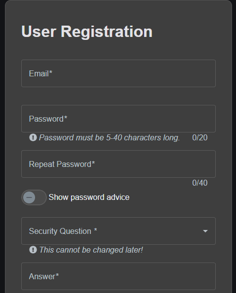

BUG-03: \[Registration] Counter shows wrong limit

Environment: OWASP Juice Shop v20.3.0 (local), Chrome, Windows 11

Requirement: REQ-REG-07

Severity: Low

Status: Draft

Steps:

1\. Open the Account menu > Login > "Not yet a customer?"

Expected: 

Password and Repeat password shows counter of 40 in denominator.

Actual: 

Password shows 20 while Repeat password shows 40.

Evidence:

